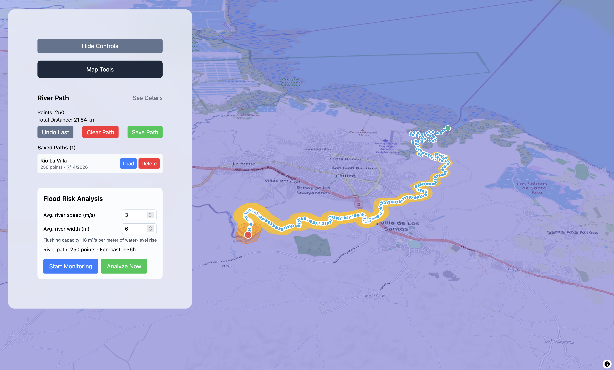

<div align="center">

# FloodPredictionSystem

**Sistema de predicción de inundaciones con datos meteorológicos en tiempo real**

[](https://react.dev/)
[](https://vite.dev/)
[](https://tailwindcss.com/)
[](https://maplibre.org/)


_Mapa 3D interactivo · Parcelas de precipitación · Modelo hidrológico de balance de masas_

</div>

## Descripción

En Panamá, y en todo el mundo, las inundaciones son un desastre inmediato y casi impredecible. Sus efectos repercuten en la sociedad, especialmente en quienes residen en zonas geográficas aisladas: interrupciones del transporte, daños a viviendas e infraestructura, pérdida de cultivos y, en algunos casos, vidas humanas en peligro.

La falta de sistemas de alerta temprana en muchas de estas áreas limita la capacidad de respuesta. **FloodPredictionSystem** busca cerrar esa brecha: utiliza datos hidrológicos y meteorológicos disponibles públicamente para estimar el riesgo de inundación a lo largo de un río y ofrecer señales generales de alerta para la evacuación civil.

## Características

- **Mapa 3D interactivo** con terreno exagerado, sombreado de relieve (_hillshade_) e inclinación de cámara ajustable.
- **Capa de precipitación en vivo**, con pronósticos de +0h hasta +72h provistos por parcelas meteorológicas públicas.
- **Trazado de ríos con clics** sobre el mapa, con guardado, carga y eliminación de rutas en el navegador.
- **Lectura de lluvia píxel por píxel**: el sistema decodifica el color de cada parcela de precipitación y lo convierte a mm/h según la leyenda oficial del proveedor.
- **Modelo hidrológico de balance de masas**: calcula cuánta agua cae sobre la cuenca, cuánta desaloja el río según su **velocidad** y **ancho promedio** (ingresados por el usuario), y cuánto debe subir el nivel del agua.
- **Zonas de riesgo en el mapa**, coloreadas por severidad (bajo-extremo) y con radio proporcional a la crecida estimada.

## Funcionamiento

### 1. Escala de colores de las parcelas de precipitación

Cada píxel de las parcelas meteorológicas se convierte a una tasa de lluvia (mm/h) usando la leyenda oficial de OpenPortGuide, verificada muestreando las teselas reales:

|                          Color                           | RGB         | Tasa (mm/h) |                          Color                           | RGB           | Tasa (mm/h) |
| :------------------------------------------------------: | :---------- | :---------- | :------------------------------------------------------: | :------------ | :---------- |
|  | `0,255,255` | ≥ 0.1       |  | `0,0,139`     | ≥ 4         |
|  | `0,204,255` | ≥ 0.2       |  | `128,0,128`   | ≥ 7         |
|  | `0,153,255` | ≥ 0.4       |  | `173,0,173`   | ≥ 10        |
|  | `0,102,255` | ≥ 0.7       |  | `219,0,219`   | ≥ 20        |
|  | `0,51,255`  | ≥ 1         |  | `252,88,252`  | ≥ 40        |
|  | `0,0,215`   | ≥ 2         |  | `252,151,252` | ≥ 70        |

### 2. Lluvia acumulada entre parcelas

La lluvia caída sobre un punto entre la parcela actual y la siguiente (se utiliza 6h entre parcelas, por limitaciones de el proveedor de parcelas meteorológicas; el modelo es adaptable a parcelas cada 1h), y se estima con la regla del trapecio:

```
profundidad (mm) = Δt · (R_actual + R_siguiente) / 2
```

### 3. Desalojo del río y crecida

La lluvia que cae en la franja de cuenca entra al río como caudal lateral y viaja aguas abajo a la **velocidad promedio del río** `v`. Un río de **ancho promedio** `w` desaloja `v · w` m³/s por cada metro de profundidad adicional, por lo que la crecida necesaria para evacuar un caudal de tormenta `Q` es:

```
Δh = Q / (v · w)
```

`Δh` determina el nivel de riesgo mostrado en el mapa: **bajo** (≥ 0.1 m), **moderado** (≥ 0.5 m), **alto** (≥ 1.5 m) y **extremo** (≥ 3 m).

## Tecnologías

| Tecnología                                                                                                                                           | Uso                                                                                             |
| :--------------------------------------------------------------------------------------------------------------------------------------------------- | :---------------------------------------------------------------------------------------------- |
| [](https://react.dev/)                                                | Interfaz de usuario y manejo de estado                                                          |
| [](https://vite.dev/)                                                     | Empaquetado y servidor de desarrollo                                                            |
| [](https://maplibre.org/)                               | Renderizado del mapa 3D (vía [@vis.gl/react-maplibre](https://visgl.github.io/react-maplibre/)) |
| [](https://tailwindcss.com/)                           | Estilos de la interfaz                                                                          |
| [](https://developer.mozilla.org/es/docs/Web/API/Canvas_API) | Decodificación píxel a píxel de las parcelas de lluvia                                          |

## Compilación del programa

Requisitos: [Node.js](https://nodejs.org/) 18 o superior.

```bash
# 1. Clonar el repositorio
git clone https://github.com/tacosconpasta/FloodPredictionSystem.git
cd FloodPredictionSystem

# 2. Instalar dependencias
npm install

# 3. Servidor de desarrollo (http://localhost:5173)
npm run dev

# 4. Compilar para producción (genera dist/)
npm run build

# 5. Previsualizar la compilación de producción
npm run preview
```

**Uso rápido:** ejecutar `npm run dev`, hacer click sobre el mapa para trazar el recorrido del río a analizar, ingresar: la velocidad (m/s) y el ancho (m) promedio del río en el panel _Flood Risk Analysis_, y presionar **Analyze Now**.

## Fuentes de datos

| Fuente                                                               |                                                                                          Logo                                                                                          | Datos que aporta                                                                                                                                                                      |
| :------------------------------------------------------------------- | :------------------------------------------------------------------------------------------------------------------------------------------------------------------------------------: | :------------------------------------------------------------------------------------------------------------------------------------------------------------------------------------ |
| [OpenPortGuide](https://weather.openportguide.de/)                   |                                                  [](https://weather.openportguide.de/)                                                  | **Parcelas de precipitación** (`precipitation_shaded`, modelo GFS de NOAA). Teselas ráster con pronósticos a +0/6/12/24/36/48/60/72h, actualizadas cada 6h, disponibles hasta zoom 7. |
| [OpenStreetMap](https://www.openstreetmap.org/)                      |           <a href="https://www.openstreetmap.org/"></a>           | **Mapa base** (calles, ciudades, ríos). © Colaboradores de OpenStreetMap, bajo licencia [ODbL](https://www.openstreetmap.org/copyright).                                              |
| [Terrain Tiles en AWS](https://registry.opendata.aws/terrain-tiles/) | <a href="https://registry.opendata.aws/terrain-tiles/"></a> | **Elevación del terreno 3D** (formato _terrarium_, proyecto Mapzen/Linux Foundation alojado, en AWS Open Data).                                                                       |

> Este proyecto usa exclusivamente servicios públicos y gratuitos, lo que impone límites: las parcelas de lluvia tienen resolución de ~25 km (GFS), límites de 6 horas, asíncronas (no reflejan el verdadero forecast desde el tiempo actual) y zoom máximo 7. El modelo está diseñado para mejorar automáticamente si se conectan fuentes con parcelas actuales con refrescadas cada hora.

## Estructura del proyecto

```
src/
├── App.jsx                          # Composición principal y estado global
├── components/
│   ├── FloodRiskManager.jsx         # Panel de análisis de riesgo (velocidad/ancho del río)
│   ├── MapTools.jsx                 # Herramientas del mapa (inclinación, pronóstico, opacidad)
│   └── controls/                    # Controles individuales de la interfaz
└── lib/
    ├── precipitationAnalyzer.js     # Decodificación de parcelas → mm/h y lluvia acumulada
    ├── createRiverPathStorage.js    # Persistencia de rutas de río (localStorage)
    └── utils/
        ├── createMapStyle.js        # Estilo MapLibre (capas, fuentes, zonas de riesgo)
        └── floodRiskCalculator.js   # Modelo hidrológico: caudal, crecida y zonas
```

## Créditos

Desarrollado como sistema de alerta temprana de inundaciones para Panamá. Los datos meteorológicos, cartográficos y de elevación pertenecen a sus respectivos proveedores y se usan conforme a sus términos de atribución.

Gracias a las entidades:

- Amazon Web Services (AWS) | Amazon.com, Inc.
- OpenStreetMap (OSM) | Colaboradores de Open Street Map
- Weather.OpenPortGuide | OpenPortGuide | Thomas Krüger Weather Service
